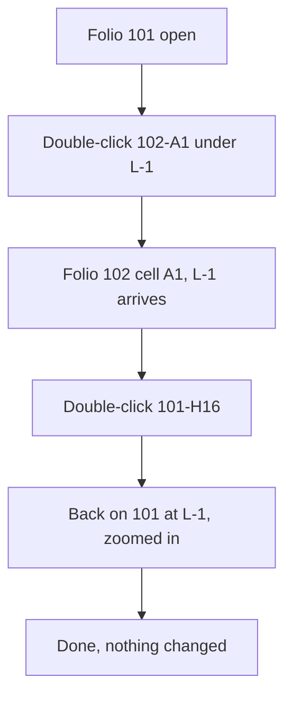

1. Keep or drop
8 - For following potentials across folios it is as quick as QET, so this part would not stop me.
2. Where it lost me
- t0001: on 102 the arrival is not highlighted, I found L-1 by the zoom position.
- t0002: 102-A1 labels sit between the L-1 and N-1 arrows, I could not tell at once which is which.
3. What the tool is
A cabinet drawing program like QET: folios with a cell frame, symbols, wires, and cross-references you can double-click to jump between folios, plus a project check.
4. Broken
Nothing broke. On return (t0002) it came back zoomed to 138 % on the arrow rather than the full-folio view I had left.
5. My design against the brief
Changed nothing. Followed L-1 from 101 to 102-A1 and back via 101-H16. Two inputs here; in QET also about two double clicks, same time.
6. Flow chart

7. Good
Double-click on the cross-reference works exactly like QET; the status bar shows folio-cell under the pointer (102-B5); Saved indicator shows I changed nothing.
8. What I could not read
- t0000: the cross-reference texts at the bottom right (around 1300,725-760) and the left-edge incoming references (around 495-570,640-695) are tiny and overlap at full-folio zoom.
- t0002: 102-A1 labels overlapping the arrows (880,560-600).
