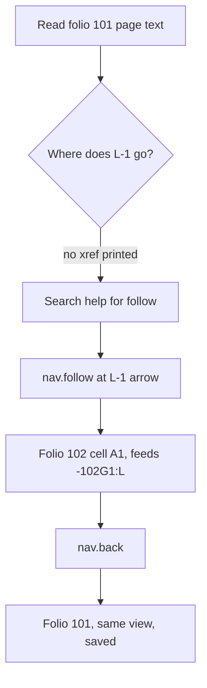

1. Keep or drop
7 - Following a cross-reference and coming back is quicker than in QET, but one task is too little to decide on.
2. Where it lost me
- The page text of 101 prints L-1 in H16 without its target (no "102.A1"), so I could not see where it went before following it.
- Finding the action: I found nav.follow by searching the help for "follow"; nothing on the page pointed me to it.
- After one jump, tabs showed back 2 on folio 102 (back 1 after Back), so the history seems to hold one entry too many.
3. What the tool is
A QET-style ECAD for cabinet documentation: folios with cell frames, devices with tags, interruption points for potentials that carry on to other folios, and page navigation (Go to, Follow, Back) that you can also drive from the keyboard.
4. Broken
Nothing failed or was refused. nav.follow at 273.353 171.581 and nav.back both came back done.
5. The drawing set against the design language
Folio 101 reads like a QET folio: cells A-H/0-16, tags like -101F1, S51, terminal strip 1X1, and interruption points L-1/N-1/PE-1.1 at the right edge, with junction dots. Every wire is still "route provisional". In QET, following L-1 takes a double-click on the folio report and Back by hand, about 10 seconds. I needed 2 steps plus a page read, about the same, and Back restored my view exactly, which QET does not do.
6. Flow chart

7. Good
Follow by the arrow's position lands right on the arrival cell. Back restores the zoom and view. The page text gives cells, potentials and wire counts, and nothing changed in the drawing.
