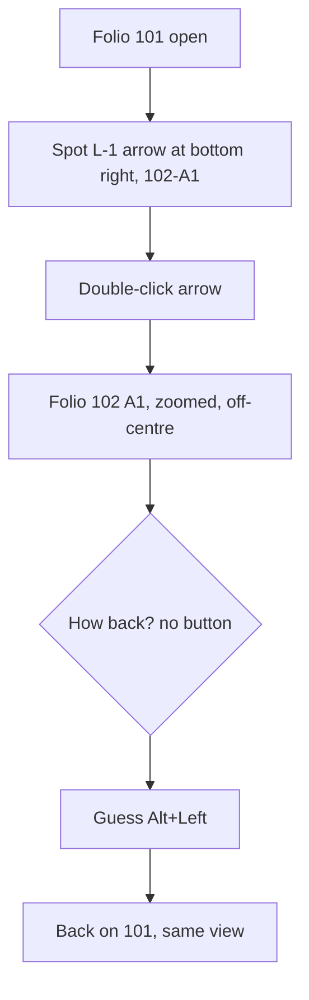

1. Keep or drop
7 - Cross-reference jumping is quicker than QET, so I would keep trying it for real work.
2. Where it lost me
- t0001: after the jump the 101 tab was gone and no back button was visible; I had to guess Alt+Left.
- t0001: the arrival landed at the left edge with a large grey void, not centred.
3. What the tool is
A QET-like desktop ECAD for control cabinets: folios with a cell grid, devices, wires, potentials with cross-references between folios, and project checks.
4. Broken
Nothing broke. The arrival view (t0001) is oddly offset.
5. My design against the brief
Changed nothing. Followed L-1 from 101 (H16) to 102 A1 by double-click and back with Alt+Left: 2 turns. In QET about the same (right-click, go to), maybe slightly slower.
6. Flow chart

7. Good
Double-click on the reference arrow jumps and zooms to the cell; Alt+Left restores exact view; cell address in status bar (102-B5).
8. What I could not read
t0000: cross-reference labels at the bottom right (102-A1, L-1, N-1) and the left-edge arrow labels around (495-570, 640-695) are tiny and overlap; the title block text is very small.
